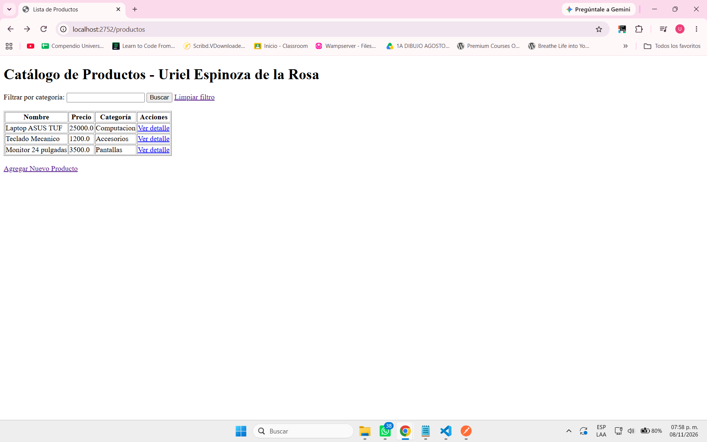
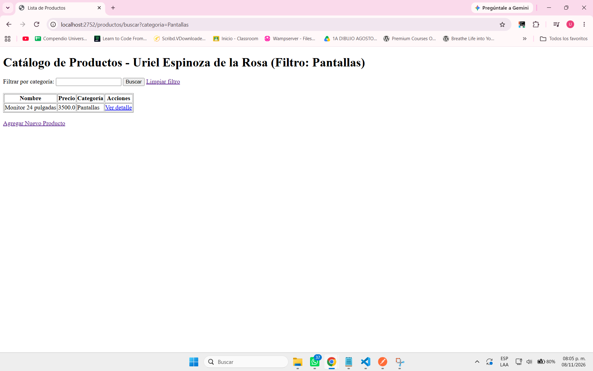
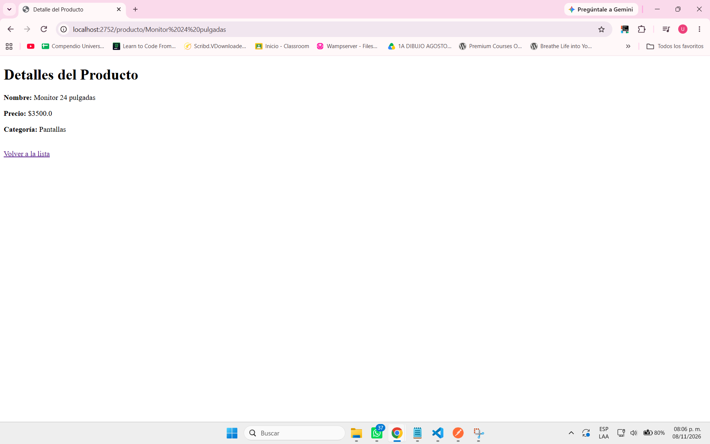
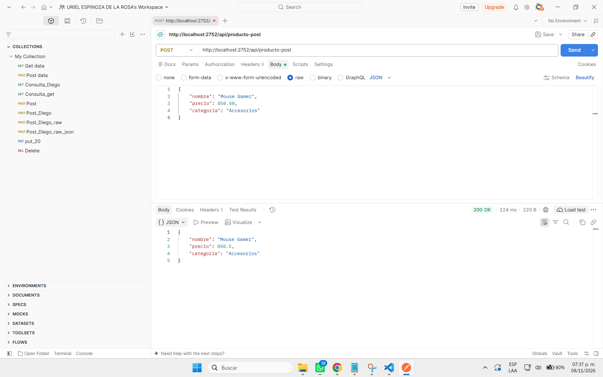

# Actividad 2: Spring MVC, Thymeleaf y DTOs

**Alumno:** Uriel Espinoza de la Rosa
**Repositorio:** EDLRUact2_t4

---

## 1. Vista principal con listado (Uso de `th:each` y `@Value`)
En esta vista se implementó el patrón MVC utilizando Thymeleaf. El controlador envía una lista de objetos `ProductoDTO` a través del objeto `Model`, y la vista HTML los recorre dinámicamente utilizando la directiva `th:each` para generar la tabla. Además, el nombre del estudiante en el título es inyectado desde el archivo `application.properties` usando la anotación `@Value`.

## 2. Formulario para nuevo producto (Uso de `@ModelAttribute`)
Se diseñó un formulario HTML que mapea directamente sus campos a las propiedades de la clase `ProductoDTO` mediante la directiva `th:object` y `th:field`. Al enviar el formulario (petición POST), el controlador recibe el objeto estructurado gracias a la anotación `@ModelAttribute` y lo agrega a la lista global.

## 3. Búsqueda por categoría (Uso de `@RequestParam`)
Para el filtrado de datos, se configuró un endpoint que recibe un parámetro por URL (`?categoria=X`) utilizando la anotación `@RequestParam`. El controlador procesa este parámetro, filtra la lista de productos original y retorna la misma vista de la tabla actualizada solo con las coincidencias.

## 4. Detalles del producto (Uso de `@PathVariable`)
Se implementó una ruta dinámica (`/producto/{nombre}`) para consultar artículos individuales. A través de la anotación `@PathVariable`, el controlador extrae el nombre directamente de la URL, busca el objeto correspondiente en el catálogo y lo envía a una nueva vista de detalles estructurada con Thymeleaf.

## 5. Petición POST en API REST (Uso de `@RequestBody`)
Para demostrar el manejo de datos crudos sin vistas HTML, se creó un controlador independiente (`@RestController`). Este endpoint recibe un payload en formato JSON directamente desde Postman, lo convierte automáticamente a un objeto `ProductoDTO` mediante `@RequestBody` y lo retorna comprobando la comunicación exitosa (Status 200 OK).

